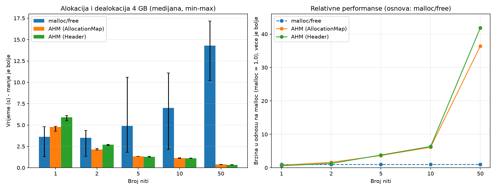

# Advanced Heap Manager (AHM)

AHM is a C++ memory manager for Windows that reduces **heap contention** in multithreaded programs. Instead of sending every allocation through one shared heap (and one lock), it spreads allocations over several independent Windows heaps in round-robin order and always returns memory to the heap it came from.

## The problem

A standard heap protects its internal structures with a global lock. Under heavy multithreaded allocation, threads queue up on that lock: allocations are effectively serialized, CPU time is spent waiting, and adding threads can make things worse instead of better. This is typical for servers that allocate temporary buffers per connection.

## How it works

- **Heap pool.** `Initialize(heapCount, heapSizeBytes, strategy)` creates `heapCount` Windows heaps with `HeapCreate(HEAP_NO_SERIALIZE, ...)`. Windows' own per-heap lock is disabled; AHM uses one `SRWLOCK` per heap instead.
- **Round-robin selection.** `Malloc` takes a ticket from an atomic counter (`fetch_add`, relaxed) and picks `heap = ticket % heapCount`. No extra synchronization is needed to spread the load.
- **Returning memory to the right heap.** `Free` must know which heap owns a pointer. AHM supports two interchangeable ways to do that, selected at `Initialize` time:

| Strategy | How `Free` finds the owning heap | Cost |
|---|---|---|
| `Strategy::Map` (default) | Looks up `ptr -> heapId` in `AllocationMap`, a segmented hash table (64 segments, each with its own lock, open addressing with linear probing and tombstones). | Hashing, a segment lock and probing on every `Malloc` and `Free`; extra memory for the table. |
| `Strategy::Header` | Reads a 16-byte `AllocationHeader` (`heapId`, `magic`) stored directly in front of the block. `Malloc` returns the address just after the header. | 16 bytes per allocation; no hash table and no extra locks. |

The header is 16 bytes (not 8) so that the pointer returned to the user keeps the 16-byte alignment that `HeapAlloc` provides.

Both strategies exist side by side so they can be compared directly (see [Benchmarks](#benchmarks)).

## Repository layout

```
Advanced Heap Manager/
  AHM/            static library: AdvancedHeapManager, AllocationMap, AllocationHeader, HeapEntry
  TestApp/        benchmark: allocate and free 4 GB from 1, 2, 5, 10 and 50 threads
  TestServer/     benchmark: multi-client server on loopback sockets
docs/             project specification and documentation (PDF, in Serbian)
results/          benchmark results: CSV data and charts (shown in the Results section)
```

## Building

Requirements: Windows, Visual Studio with the *Desktop development with C++* workload (the projects use the v143 toolset; newer Visual Studio versions may offer to retarget it).

1. Open `Advanced Heap Manager/Advanced Heap Manager.sln`.
2. Build the solution. `TestApp` and `TestServer` link against the `AHM` static library.

AHM uses the Win32 heap API, `SRWLOCK` and (in `TestServer`) Winsock, so it is Windows-only.

## Benchmarks

Both programs run three configurations back to back: standard `malloc`/`free`, AHM with `Strategy::Map` and AHM with `Strategy::Header`. Each configuration is repeated three times and the **median** is reported (the minimum and maximum are kept in the CSV output).

For meaningful numbers, run a **Release x64** build **without a debugger attached** (Visual Studio: *Debug > Start Without Debugging*, Ctrl+F5). A debugger changes how the Windows heap behaves. Close other heavy programs; each run touches several GB of memory.

### TestApp

- Allocates and then frees 4 GB in 64 KB blocks, split evenly over 1, 2, 5, 10 and 50 threads, using 8 AHM heaps.
- Every page of each block is written once so that operating-system page commit is not mixed into the measurement.
- Writes `results.csv` (columns: `strategy,threads,median_s,min_s,max_s`).
- To draw the charts:

  ```
  python -m pip install matplotlib
  python plot_results.py
  ```

  This produces `results.png` (time per thread count, and speed relative to `malloc`).

### TestServer

- A server and several clients run as threads of one process and talk over TCP on `127.0.0.1:5555`.
- Clients send messages of random size (64 B to 4 KB) and the server answers with random-size replies; both sides allocate their buffers with AHM or `malloc`.
- All clients connect first and are then released at the same moment; the timer starts at the release, so connection setup is not part of the measurement.
- The program asks for the number of clients and messages per client, prints a table (median, min, max, throughput) and appends the results to `server_results.csv`, so several client counts can be collected in one file.
- If a run prints a warning (for example that fewer clients connected, or fewer messages were processed, than expected), that run is not reliable and should be repeated.

## Results

All measurements: Intel Core Ultra 7 258V (8 cores, 8 threads), 32 GB RAM, Release x64 build without a debugger, median of 3 runs.

### TestApp (4 GB in 64 KB blocks, 8 AHM heaps)

Min-max ranges are in [`results/results.csv`](results/results.csv).



| Threads | malloc/free (s) | AHM Map (s) | AHM Header (s) | Map vs malloc | Header vs malloc |
|---:|---:|---:|---:|---:|---:|
| 1  | 3.624  | 4.785 | 5.900 | 0.76x  | 0.61x  |
| 2  | 3.502  | 2.147 | 2.706 | 1.63x  | 1.29x  |
| 5  | 4.908  | 1.336 | 1.293 | 3.67x  | 3.80x  |
| 10 | 7.003  | 1.140 | 1.100 | 6.14x  | 6.37x  |
| 50 | 14.302 | 0.393 | 0.342 | 36.43x | 41.88x |

(Ratios above 1.00x mean AHM is faster than `malloc`/`free`.)

- **Contention is visible.** The work is the same in every row, yet `malloc`/`free` gets slower as threads are added (3.6 s to 14.3 s), while AHM gets faster (to 0.39 s and 0.34 s with 50 threads).
- **From 5 threads up, AHM is clearly faster:** about 3.7x with 5 threads, 6x with 10 and 36-42x with 50. At these thread counts even the slowest AHM run beats the fastest `malloc` run, so the result is not noise.
- **With 1-2 threads there is no demonstrated benefit.** `malloc` runs varied from 1.3 s to 4.8 s and got slower with every repetition, so the comparison is inconclusive there.
- **Header vs Map:** Header was about 13% faster with 50 threads, showed no measurable difference with 5 and 10 threads, and was about 25% slower with 1-2 threads.

### TestServer (loopback TCP, 5000 messages per client, 64 B - 4 KB)

Min-max ranges are in [`results/server_results.csv`](results/server_results.csv). Each cell shows the time and, in brackets, the throughput in messages per second.

| Clients | malloc/free | AHM Map | AHM Header | Map vs malloc | Header vs malloc |
|---:|---:|---:|---:|---:|---:|
| 1  | 0.191 s (26,224) | 0.199 s (25,102) | 0.204 s (24,496) | 0.96x | 0.93x |
| 10 | 0.653 s (76,517) | 0.649 s (77,074) | 0.676 s (74,018) | 1.01x | 0.97x |
| 50 | 2.753 s (90,802) | 2.840 s (88,042) | 2.861 s (87,387) | 0.97x | 0.96x |

- **No measurable advantage for AHM in this test.** With 1 and 10 clients the min-max ranges of all three overlap and no method wins in every run, so the differences are run-to-run variation. With 50 clients `malloc` was marginally faster (about 3%) in all three runs. Header vs Map stayed within 4% in every row.
- **Throughput saturates:** about 26,000 messages/s with one client, 74,000-77,000 with 10 and 87,000-91,000 with 50.
- **Possible reasons (not profiled).** One message exchange takes only about 38 microseconds with a single client and involves four small allocations plus several loopback socket calls, so allocation is a small part of the total. In addition, Microsoft documents that the low-fragmentation heap, which the default process heap uses for small blocks, cannot be enabled for heaps created with `HEAP_NO_SERIALIZE` (as AHM's are), so the default allocator may already scale well for blocks of this size.

### Overall conclusion

AHM removes the heap-contention bottleneck when allocation itself dominates the work: in TestApp, with 5 or more threads, it is several times to dozens of times faster than the default `malloc`/`free` and keeps scaling as threads are added. With 1-2 threads it brings no advantage. In the TestServer scenario, where each message is mostly socket communication and the blocks are small, AHM and `malloc`/`free` performed practically the same, so no benefit can be claimed there.

The header-based strategy adds a small gain only under the highest contention (50 threads in TestApp), is indistinguishable from the map-based one in most other cases, and is slower with 1-2 threads. Its other benefits (no hash table, no segment locks, simpler code) are not visible in these timings.

Limitations: 3 repetitions per configuration and a single machine.

## Limitations

- **Windows only.**
- **`Strategy::Header` trusts the pointer it is given.** `Free` reads the 16 bytes in front of the pointer, so passing a pointer that did not come from `AHM::Malloc` is undefined behaviour. Double-free detection is best effort (the magic value is cleared on free, but two threads freeing the same pointer at the same moment can both pass the check). `Strategy::Map` is stricter: an unknown pointer is simply ignored.
- **The strategy is fixed per `Initialize` call.** A pointer must be freed under the same strategy it was allocated with. Calling `Initialize` again resets the manager.
- **`Shutdown` destroys all heaps**, which also releases any blocks that were never freed.
- `AHM::Malloc(0)` returns `nullptr`.

## Documentation

The `docs/` folder contains the original assignment and the project documentation. These documents are written in Serbian.

- `docs/Projekat24.pdf` - assignment
- `docs/AHM_Dokumentacija.pdf` - project documentation
- `docs/Dizajn_tim24.pdf` - design document
